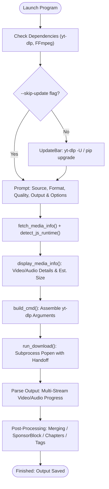

<p align="center">
  
</p>

<h1 align="center">AS YouTube Downloader</h1>

<p align="center">
  <strong>An elegant, interactive, and robust terminal interface for downloading YouTube media via yt-dlp.</strong>
</p>

<p align="center">
  <a href="https://github.com/17Arigato-jwd/youtube-downloader/releases"></a>
  <a href="https://www.python.org/downloads/"></a>
  <a href="https://github.com/yt-dlp/yt-dlp"></a>
  <a href="https://ffmpeg.org/"></a>
  
</p>

---

## 📖 Table of Contents

- [Overview](#-overview)
- [Key Features](#-key-features)
- [Terminal Preview](#-terminal-preview)
- [Prerequisites](#-prerequisites)
- [Installation](#-installation)
- [Quick Start](#-quick-start)
- [Interactive Guide & Options](#-interactive-guide--options)
  - [Format & Quality Presets](#format--quality-presets)
  - [Batch & Playlist Support](#batch--playlist-support)
  - [SponsorBlock & Chapters](#sponsorblock--chapters)
  - [Browser Cookies & Authentication](#browser-cookies--authentication)
- [Command-Line Flags](#-command-line-flags)
- [How It Works](#-how-it-works)
- [Troubleshooting](#-troubleshooting)
- [License](#-license)

---

## 🌟 Overview

**AS YouTube Downloader** combines the raw speed and power of [yt-dlp](https://github.com/yt-dlp/yt-dlp) with an intuitive, guided terminal experience. It eliminates the need to remember long, cryptic CLI flags while offering features that bare downloaders leave out:

- **Automated Dependency Health & Self-Updates**: Automatically checks for and updates `yt-dlp` upon launch with a smooth animated loading bar.
- **Automated JavaScript Runtime Discovery**: Solves YouTube's throttling `n-challenge` signature deciphering by auto-detecting Node.js or Deno across common paths, version managers (`nvm`, `fnm`), and sandboxed environments.
- **Dynamic Monotonic Progress Tracking**: An in-place 3-line terminal progress bar that tracks video download, audio download, and FFmpeg post-processing stages without ever resetting backwards.
- **Pre-Download Media Inspection**: Queries and displays complete video and stream metadata (resolution, frame rate, audio bitrates, estimated file size) before initiating the download.

---

## ✨ Key Features

| Feature | Description |
| :--- | :--- |
| **🎨 Polished Terminal UI** | Clean sections, rich ANSI colors, responsive spinners, and flexible input validation accepting any yes/no variant (`y`, `yes`, `sure`, `affirmative`, `n`, `nope`, etc.). |
| **📊 Real-time Progress Bar** | Multi-stream awareness separates video and audio downloads smoothly; live ticker continues smoothly through post-processing stages. |
| **🔍 Media Inspector** | Previews title, channel, duration, requested video resolution & codec, audio bitrate & sample rate, and estimated file size. |
| **🚀 JS Runtime Auto-Detection** | Proactively searches for Node.js, Deno, and PhantomJS across host binaries and NVM/FNM directories to prevent YouTube speed throttling. |
| **🎵 Video & Audio Extraction** | Supports video containers (**MP4**, **MKV**, **WEBM**, **AVI**) and lossless/high-fidelity audio (**MP3**, **WAV**, **FLAC**, **M4A**, **OPUS**). |
| **🛡️ SponsorBlock Integration** | Automatically cuts out intros, outros, sponsor segments, self-promotions, and interaction reminders directly in the downloaded file. |
| **📑 Chapter Splitting** | Splits multi-topic videos into individual timestamped video/audio tracks based on YouTube chapters. |
| **🖼️ Rich Metadata & Artwork** | Embeds ID3/MP4 metadata tags and thumbnail cover art (converted to clean JPEG for broad media-player compatibility). |
| **💬 Subtitle Extraction** | Fetches manual and auto-generated closed captions in your preferred language code (e.g. `en`, `es`, `ja`). |
| **🍪 Authenticated Downloads** | Extracts session cookies from major web browsers (**Chrome**, **Firefox**, **Safari**, **Edge**, **Brave**) to access age-restricted or members-only videos. |
| **⚡ Bandwidth Throttling** | Optional download rate limiting (e.g. `2M`, `500K`) to prevent saturating shared connections. |
| **📦 Batch & Playlist Modes** | Supports single links, entire YouTube playlists with auto-numbering, or interactive multi-URL batch queues. |

---

## 🖥️ Terminal Preview

```text
╔═══════════════════════════════════════════════════════════════════╗
║  AS Youtube Downloader | based on yt-dlp | version 1.6.4          ║
╚═══════════════════════════════════════════════════════════════════╝

┌─ Updates ──────────────────────────────────────
Checking for yt-dlp updates…
──────────────────────────────────────────────────────
[██████████████████████████████]  100%
✓  yt-dlp is up to date (v2025.02.19)

┌─ Source ───────────────────────────────────────
  Mode [single | single/batch]: single
  YouTube URL: https://www.youtube.com/watch?v=dQw4w9WgXcQ

┌─ Format & Quality ─────────────────────────────
  Audio: MP3 | WAV | FLAC | M4A | OPUS
  Video: MP4 | MKV | WEBM | AVI
  Format [MP3]: MP4
  Video quality [1080p | lowest/360p/480p/720p/1080p/1440p/4k/highest]: 1080p

┌─ Output ───────────────────────────────────────
  Filename / template (no extension) [%(title)s]: %(title)s
  Output directory [/home/user/Downloads]: /home/user/Downloads

┌─ Options ──────────────────────────────────────
  Embed metadata & thumbnail? [yes | yes/no]: yes
  Download subtitles? [no | yes/no]: no
  Configure extra options? [no | yes/no]: no
  Show raw yt-dlp output? [no | yes/no]: no

┌─ Video Details ────────────────────────────────
  Title:       Rick Astley - Never Gonna Give You Up (Official Music Video)
  Channel:     Rick Astley
  Duration:    03:33
  Quality:     1080p (1920x1080 @60fps avc1)
  Audio:       mp4a @ ~128 kbps (44 kHz)
  Format:      MP4
  Est. Size:   ~68.4 MB

Downloading video…   48.2MiB  15.1MiB/s  ETA 00:01
──────────────────────────────────────────────────────
[████████████████████░░░░░░░░░░]   68%

✓  Complete!
──────────────────────────────────────────────────────
[██████████████████████████████]  100%

✓  Saved → /home/user/Downloads/Rick Astley - Never Gonna Give You Up (Official Music Video).mp4
```

---

## 📋 Prerequisites

Before running the downloader, ensure you have:

1. **Python 3.10+**: Available on your system `PATH`.
2. **FFmpeg**: Required for remuxing streams, audio format conversion, thumbnail embedding, and chapter slicing.
3. **yt-dlp**: Required core media extractor (installs via pip).
4. **JavaScript Runtime (Recommended)**: Node.js or Deno for resolving YouTube player challenge codes without speed degradation.

### Installing FFmpeg

- **Ubuntu / Debian / Mint**:
  ```bash
  sudo apt update && sudo apt install -y ffmpeg
  ```
- **Arch Linux / Manjaro**:
  ```bash
  sudo pacman -S ffmpeg
  ```
- **Fedora / RHEL**:
  ```bash
  sudo dnf install ffmpeg
  ```
- **macOS (Homebrew)**:
  ```bash
  brew install ffmpeg
  ```
- **Windows (Winget / Scoop)**:
  ```powershell
  winget install Gyan.FFmpeg
  # or
  scoop install ffmpeg
  ```

---

## 📥 Installation

1. **Clone the repository**:
   ```bash
   git clone https://github.com/17Arigato-jwd/youtube-downloader.git
   cd youtube-downloader
   ```

2. **(Optional) Set up a virtual environment**:
   ```bash
   python3 -m venv .venv
   source .venv/bin/activate  # On Windows: .venv\Scripts\activate
   ```

3. **Install Python dependencies**:
   ```bash
   pip install -r requirements.txt
   # or install directly:
   pip install colorama "yt-dlp[default,curl-cffi]"
   ```
   > [!TIP]
   > The `curl-cffi` extra provides TLS impersonation to bypass YouTube bot detection algorithms and prevent download throttling.

4. **Make the script executable** (Linux / macOS):
   ```bash
   chmod +x youtube-downloader.py
   ```

---

## 🚀 Quick Start

Run the application:
```bash
python3 youtube-downloader.py
```
Or directly if executable:
```bash
./youtube-downloader.py
```

Follow the on-screen interactive prompts to choose your format, quality, and output preferences.

---

## 🛠️ Interactive Guide & Options

### Format & Quality Presets

#### Audio Presets
When selecting an audio format (`MP3`, `WAV`, `FLAC`, `M4A`, `OPUS`), choose from:
- `highest`: VBR 0 (highest quality VBR / 320 kbps equivalent)
- `high`: VBR 2 (~190–250 kbps)
- `medium`: VBR 4 (~160 kbps)
- `low`: VBR 6 (~115–130 kbps)
- `lowest`: VBR 9 (~65–85 kbps)

#### Video Presets
When selecting a video format (`MP4`, `MKV`, `WEBM`, `AVI`), choose from:
- `highest`: Best available video + audio streams without resolution cap
- `4k`: Best video up to 2160p + best audio
- `1440p`: Best video up to 1440p + best audio
- `1080p`: Best video up to 1080p + best audio (Default)
- `720p`: Best video up to 720p + best audio
- `480p`: Best video up to 480p + best audio
- `360p`: Best video up to 360p + best audio
- `lowest`: Smallest file size / lowest available resolution

### Batch & Playlist Support

- **Single Mode**: Prompts for a single video or audio URL.
- **Batch Mode**: Enter multiple URLs, one per line. Submit a blank line when finished to start downloading the entire queue.
- **Playlist Detection**: If a link containing `list=` is provided, the downloader asks whether you want to fetch the entire playlist. Playlists are automatically named with leading index numbers: `%(playlist_index)s - %(title)s.%(ext)s`.

### SponsorBlock & Chapters

When opening the **Extra Options** sub-menu:
- **SponsorBlock**: Automatically clips and discards `sponsor`, `intro`, `outro`, `selfpromo`, and `interaction` segments without re-encoding unaffected parts.
- **Chapter Splitting**: Splits a single long video (such as podcasts, albums, or conferences) into distinct video/audio files corresponding to the author's defined chapters.

### Browser Cookies & Authentication

For age-restricted content, unlisted videos, or YouTube Premium / Member-only streams, activate browser cookie extraction in Extra Options. Supported browsers:
- `chrome`
- `firefox`
- `safari`
- `edge`
- `brave`

> [!NOTE]
> Make sure your chosen browser is closed or not actively writing to its cookie database when the download starts so yt-dlp can read the SQLite file.

---

## ⚙️ Command-Line Flags

| Flag | Purpose |
| :--- | :--- |
| *(no flags)* | Runs standard startup check and opens interactive downloader interface. |
| `--no-update` / `--skip-update` | Skips the startup yt-dlp update check (useful for offline use or slow connections). |
| `--update` | Runs the animated yt-dlp update check and immediately exits when finished. |

### Examples

```bash
# Launch without checking for yt-dlp updates
python3 youtube-downloader.py --no-update

# Run only the yt-dlp updater and exit
python3 youtube-downloader.py --update
```

---

## 🔬 How It Works



1. **Dependency Verification**: Confirms that both `yt-dlp` and `ffmpeg` are installed and reachable.
2. **Runtime Discovery**: Inspects system directories and version manager trees (`~/.nvm`, `~/.fnm`, `~/.deno`) for an executable JavaScript binary. If found, passes `--js-runtimes` directly to yt-dlp to solve anti-scraping challenges.
3. **Metadata Inspection**: Queries YouTube's API using the Python library binding or `--dump-json` to extract precise stream specs and approximate file sizes prior to downloading.
4. **Stream Handoff & Progress Computation**: Starts an animated CLI spinner while yt-dlp initializes, then hands off cleanly to a non-flickering, three-line progress display. Tracks separate audio and video payload downloads to guarantee a smooth, monotonic 0%–100% bar.

---

## ❓ Troubleshooting

### 1. YouTube downloads are extremely slow or fail with `n-challenge`
YouTube frequently updates its JavaScript challenge algorithm to throttle download speeds.
- Ensure you have **Node.js** or **Deno** installed on your system.
- Run `python3 youtube-downloader.py --update` to fetch the latest `yt-dlp` release.
- Ensure `curl-cffi` is installed: `pip install --upgrade "yt-dlp[default,curl-cffi]"`.

### 2. "Sign in to confirm you're not a bot" or Age Restrictions
Use the built-in browser cookie integration:
1. Log in to YouTube in your browser (e.g. Chrome, Firefox, or Brave).
2. Run the script and answer `yes` to **Configure extra options?**.
3. Answer `yes` to **Use browser cookies** and pick your browser.

### 3. Missing Dependencies Error
If the script exits with:
```text
✗  Missing dependencies: ffmpeg
```
Follow the [Installing FFmpeg](#installing-ffmpeg) section above for your operating system.

---

## 📄 License

This project is open-source and available under the terms of the **MIT License**. See the repository details for more information.

---

<p align="center">
  Crafted with care by <a href="https://github.com/17Arigato-jwd">17Arigato-jwd</a>.
</p>
